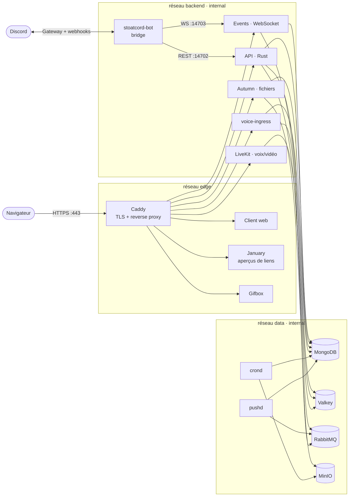

# projetBridge : pont de messagerie Discord ↔ Stoat auto-hébergé

**Projet IM Bridge, Mastère 2 Expert en Développement Full-Stack 2026/2027**

Une entreprise héberge sa propre messagerie de groupe, **Stoat** (plateforme open-source, anciennement Revolt). Ses utilisateurs sont aussi présents sur **Discord**. Un **bridge** relaie les messages dans les deux sens : un salon Discord et un salon Stoat liés se comportent comme un seul salon.

L'ensemble tient dans une stack Docker Compose de 18 services, segmentée en 4 réseaux, durcie et limitée en ressources. Le backend Stoat (Rust) et son client web (TypeScript) sont **compilés depuis leurs sources** avec nos propres Dockerfiles multi-stage. La configuration est entièrement pilotée par variables d'environnement, sans le kit `stoatchat/self-hosted`. L'installation se fait avec un script et deux tokens.

---

## 1. Correspondance avec le cahier des charges

| Exigence | Mise en œuvre | Où |
|---|---|---|
| Serveur du service choisi + base de données | Stoat v0.15.5 compilé depuis [stoatchat/stoatchat](https://github.com/stoatchat/stoatchat) (API, Events, Autumn, January…) + client [for-web](https://github.com/stoatchat/for-web) v0.15.3 + MongoDB 8, Valkey, RabbitMQ, MinIO | `docker-compose.yaml`, `docker/` |
| Au moins un bridge | `stoatcord-bot` : Discord ↔ Stoat bidirectionnel (webhooks côté Discord, *masquerade* côté Stoat) | service `stoatcord-bot` |
| Services supplémentaires | Voix/vidéo LiveKit, client web, reverse proxy Caddy avec TLS automatique | services `livekit`, `web`, `caddy` |
| Stack installable avec peu de configuration | `./setup.sh [url]` clone les sources à une version figée et génère tous les secrets (mots de passe, clés VAPID, clé de chiffrement, LiveKit). Il ne reste qu'à coller 2 tokens | `setup.sh` |
| Usage intelligent des variables d'environnement | Une seule URL (`STOAT_PUBLIC_URL`) configure toute l'instance : Caddy (HTTP ou HTTPS automatique), backend (`REVOLT__HOSTS__*`), client web (`VITE_*`, injectées au démarrage). Les fichiers de `config/` sont communs à toutes les installations et ne contiennent ni URL ni secret | `x-stoat`, `config/`, `.env.example` |
| Communication inter-services sûre | 4 réseaux dont 2 `internal`, comptes applicatifs à moindre privilège (MongoDB, MinIO), secrets Docker, authentification MongoDB | §3 |
| Images modifiées (cas d'usage, sécurité) | **Toutes nos images sont construites par nos Dockerfiles.** Backend : distroless non-root avec sonde de santé busybox. Web : non-root, compatible lecture seule. Bridge : distroless non-root avec chargeur de secrets | `docker/`, `bot/docker/` |
| Stack alternative dev/config | `docker-compose.override.yaml` : cible `dev` du bot, Watch, MongoDB sur 127.0.0.1, logs debug, profil `tools` (mongo-express) | §5 |
| **Watch** | `sync` du code source (Bun recharge à chaud), `rebuild` sur `package.json`/`Dockerfile` | override |
| **Networking** | `edge` / `backend` (internal) / `data` (internal) / `egress`, alias DNS (MinIO, domaine → Caddy), sidecar `network_mode: service:api` | §3, §8 |
| **Fragments** | `x-base`, `x-hardened`, `x-limits-*`, `x-healthcheck`, `x-stoat`, `x-logging` fusionnés avec `<<: [*a, *b]` | haut de `docker-compose.yaml` |
| **Cgroup** | Limites CPU, mémoire et PIDs sur chaque service (`deploy.resources.limits`) | `x-limits-xs/s/m/l` |
| **Multi-stage** | Backend : 1 étape de compilation Rust → **8 cibles** (une par service). Web : `builder` (pnpm + Vite) → `runtime`. Bot : `deps` → `dev` / `runtime`. Caches BuildKit (`--mount=type=cache`) | les 3 Dockerfiles |
| **Healthcheck** | 13 services surveillés. Démarrage ordonné par `depends_on: service_healthy` / `service_completed_successfully` | chaque service |

---

## 2. Architecture



`api`, `events`, `autumn`, `livekit` et `voice-ingress` sont aussi sur `edge`, pour que Caddy puisse les joindre. `pushd` et le bot sont aussi sur `egress`, pour sortir vers Internet (Web Push, Discord).

| Service | Réseaux | Pourquoi |
|---|---|---|
| `caddy`, `web`, `january`, `gifbox` | edge | exposés via Caddy ; January et Gifbox ont besoin d'Internet |
| `api`, `events`, `autumn`, `voice-ingress`, `livekit` | edge + backend + data | publiés par Caddy, appelés par le bridge, utilisent les bases |
| `crond` | data | tâches planifiées sur MongoDB et MinIO uniquement |
| `pushd` | data + egress | lit les bases et envoie des notifications Web Push |
| `stoatcord-bot` | backend + egress | parle à l'API Stoat et à Discord, **jamais aux bases** |
| `database`, `redis`, `rabbit`, `minio` | data | aucun accès Internet, aucun port publié |

---

## 2 bis. Rôle de chaque composant

### Backend Stoat (Rust, `stoat/backend`)
Stoat est découpé en **microservices** qui partagent la même configuration (`Revolt.toml` + variables `REVOLT__*`) et les mêmes bases.

| Service | Binaire | Port | Rôle |
|---|---|---|---|
| `api` | `revolt-delta` | 14702 | **API REST** (framework Rocket) : comptes, connexion, serveurs, salons, messages, permissions, bots. Expose aussi `/metrics` (Prometheus) |
| `events` | `revolt-bonfire` | 14703 | **WebSocket temps réel** : pousse aux clients les nouveaux messages, « est en train d'écrire », présences |
| `autumn` | `revolt-autumn` | 14704 | **Fichiers** : envoi, chiffrement (`FILES_ENCRYPTION_KEY`), vignettes (ffmpeg), stockage dans MinIO |
| `january` | `revolt-january` | 14705 | **Aperçus de liens** : va lire une URL (site, GIF, vidéo) et en extrait titre, image et vidéo (*embed*) |
| `gifbox` | `revolt-gifbox` | 14706 | Proxy du sélecteur de GIF (Tenor) |
| `crond` | `revolt-crond` | — | Tâches planifiées : nettoyage des fichiers orphelins, purges |
| `pushd` | `revolt-pushd` | — | Notifications push (Web Push signé par les clés VAPID) |
| `voice-ingress` | `revolt-voice-ingress` | 8500 | Reçoit les événements de LiveKit (qui rejoint ou quitte un salon vocal) |

**Bases utilisées :**
- **MongoDB** : toutes les données (utilisateurs, serveurs, messages) ;
- **Valkey (Redis)** : cache, présences, diffusion des événements entre `api` et `events` ;
- **RabbitMQ** : file de tâches internes (notifications, mentions) ;
- **MinIO** : stockage S3 des fichiers.

**Voix et vidéo :** **LiveKit** (serveur WebRTC) transporte l'audio et la vidéo en UDP. L'API lui délivre des jetons d'accès signés avec `LIVEKIT_SECRET`.

### Client web (TypeScript / SolidJS, `stoat/web`)
- Application monopage compilée par **Vite**, servie par `sirv` dans le conteneur `web`.
- Au démarrage, elle ne connaît que **l'adresse de l'API** (`VITE_API_URL`). Elle appelle `GET /api/`, et **le backend lui répond avec toutes les autres adresses** : WebSocket, Autumn, January, LiveKit (variables `REVOLT__HOSTS__*`).
- Ensuite :
  - les actions passent par l'**API REST** (envoyer un message, créer un salon…) ;
  - les mises à jour arrivent en direct par le **WebSocket** d'`events` ;
  - les fichiers sont envoyés à **Autumn** ;
  - les images des aperçus passent par **January**.

### Caddy (reverse proxy)
- **Point d'entrée unique**. Une seule origine pour le navigateur, donc pas de problème de CORS.

| Préfixe | Service |
|---|---|
| `/api` | api |
| `/ws` | events |
| `/autumn` | autumn |
| `/january` | january |
| `/gifbox` | gifbox |
| `/livekit` | livekit |
| reste | web |

- Il **bloque `/api/metrics`**, sert `/.well-known/stoat` (découverte de l'instance) et gère le **HTTPS automatique** (Let's Encrypt) avec un vrai domaine.
- **Sidecar `api-loopback`** : relaie le `127.0.0.1:80` de l'API vers Caddy, pour que l'API puisse joindre January par l'URL publique en local (voir *Limites connues*).

### Bridge `stoatcord-bot` (TypeScript / Bun, `bot/stoatcord-bot`)
Un seul programme connecté aux **deux plateformes à la fois** :

```
          Discord                          stoatcord-bot                            Stoat
 ┌─────────────────────┐   Gateway   ┌──────────────────────────┐   REST :14702  ┌──────────┐
 │ #salon Discord      │◄───────────►│ client Discord (discord.js) │──────────────►│ api      │
 │                     │◄── webhook ─│ relais + conversion format │   WS :14703    │          │
 └─────────────────────┘             │ base SQLite (liens, IDs)   │◄──────────────│ events   │
                                     │ API HTTP :3210 (/health)   │               └──────────┘
                                     └──────────────────────────┘
```

| Élément | Rôle |
|---|---|
| **Client Discord** (discord.js, Gateway) | Reçoit en direct les messages, modifications, suppressions et réactions des salons Discord. Enregistre les commandes `/link`, `/unlink`, `/status`, `/migrate`… |
| **Client Stoat REST + WebSocket** | Envoie les messages vers Stoat (`POST /channels/:id/messages`) et écoute le WebSocket d'`events`. En secours, il interroge l'API toutes les 5 s (*REST poll fallback*) |
| **Discord → Stoat : *masquerade*** | Le message est publié par le bot Stoat, mais affiché avec **le nom et l'avatar de l'auteur Discord**. D'où la permission **Masquerade** |
| **Stoat → Discord : *webhook*** | Le bot crée un **webhook** dans le salon Discord (`/link`), qui permet de publier sous le nom et l'avatar de l'auteur Stoat |
| **Anti-écho** | Chaque message relayé est mémorisé : le bot ne renvoie jamais un message qu'il vient lui-même de publier, sinon il y aurait une boucle infinie |
| **Synchronisation complète** | Messages, **modifications**, **suppressions**, **réactions**, « en train d'écrire », pièces jointes, conversion du markdown |
| **Base SQLite** (volume `bridge_data`) | `channel_links` (quel salon Discord ↔ quel salon Stoat), `bridge_messages` (paires d'IDs pour retrouver un message à modifier ou supprimer) |
| **Reprise après coupure** (*outage recovery*) | Au redémarrage, il récupère les messages envoyés pendant que le bridge était arrêté |
| **API HTTP** (:3210) | `/api/health` (sonde de santé), gestion des liens. Protégée par `API_KEY` (secret Docker) |

**Comment le bridge est relié à Stoat :**
- **Mode normal** : il parle à `api` et `events` **directement par le DNS Docker**, sur le réseau `backend`, sans passer par Caddy. Il n'a **aucun accès** aux bases (`data`).
- **Mode distant** : il parle au backend de l'autre PC par le **tunnel WireGuard**, via le réseau `egress`.

### Mode distant : partage réseau par WireGuard
- **WireGuard** crée sur chaque PC une **carte réseau virtuelle** (ici `10.8.0.3` pour ce PC, `10.8.0.1` pour le PC backend), reliée aux autres par un **tunnel chiffré**. Seuls les pairs dont la clé publique est connue peuvent y entrer.
- Un conteneur ne connaît pas WireGuard. Le trafic part du réseau Docker `egress`, sort par Windows, et Windows l'envoie dans le tunnel pour les adresses `10.8.0.x`. C'est pour ça que le bridge doit être sur un réseau **non-internal** pour joindre le PC distant.
- **Ce qui traverse le tunnel :** l'API (REST), le WebSocket, Autumn et LiveKit du PC distant.
- **Ce qui ne le traverse jamais :** les bases de données, qui restent internes au PC backend.

---

## 3. Sécurité

### Segmentation réseau (vérifiée)
`data` et `backend` sont déclarés `internal: true` : Docker ne leur donne aucune route vers Internet. Un conteneur ne voit que les réseaux dont il est membre. Résultats des tests de connexion depuis le conteneur du bridge :

```
bridge -> api:14702        JOIGNABLE
bridge -> events:14703     JOIGNABLE
bridge -> database:27017   BLOQUÉ
bridge -> redis:6379       BLOQUÉ
bridge -> rabbit:5672      BLOQUÉ
bridge -> minio:9000       BLOQUÉ
redis  -> Internet         BLOQUÉ (bad address 'discord.com')
```

Seuls Caddy (80/443) et LiveKit (7881/tcp, 41000-41100/udp pour le WebRTC) publient des ports.

### Moindre privilège sur les données
- **MongoDB** : l'authentification est activée. Stoat utilise un compte `stoat` limité à `readWrite` + `dbAdmin` sur la base `revolt`, créé par `docker/mongo/init-app-user.js`. Le compte root ne sert qu'à l'initialisation.
- **MinIO** : `createbuckets` crée un compte de service `autumn` avec la politique `readwrite`. Le compte root MinIO n'est jamais donné à l'application.
- **RabbitMQ** : les identifiants sont générés aléatoirement et ne sont plus les valeurs par défaut `rabbituser`/`rabbitpass` de la stack officielle.

### Secrets
- `setup.sh` génère tous les mots de passe aléatoirement (`openssl rand -hex 24`).
- Les tokens du bridge sont des **secrets Docker** (`./secrets/*.txt`, montés dans `/run/secrets/`). `docker inspect` n'affiche que `DISCORD_TOKEN_FILE=/run/secrets/discord_token`, jamais la valeur.
- Le bot amont ne lit que des variables d'environnement. Notre `entrypoint.ts` convertit chaque `XXX_FILE` en `XXX` au démarrage, sans modifier le code amont.
- `.env`, `secrets/` et `data/` sont exclus de Git.

### Durcissement des conteneurs (fragment `x-hardened`)
| Mesure | Effet |
|---|---|
| `cap_drop: [ALL]` | aucune capacité Linux. Caddy récupère uniquement `NET_BIND_SERVICE` pour écouter sur 80/443 |
| `read_only: true` + `tmpfs /tmp` | système de fichiers immuable : un attaquant ne peut rien y déposer |
| `no-new-privileges` | interdit l'élévation via des binaires setuid |
| utilisateur non-root | `nonroot` (backend Stoat), `node` (client web) et `65532` (bridge) |
| images distroless | ni shell ni gestionnaire de paquets dans le bridge et le backend Stoat |
| `init: true` (bridge) | un vrai PID 1 relaie les signaux et ramasse les zombies |
| rotation des logs | `json-file`, 10 Mo × 3 fichiers par service |

---

## 4. Images Docker

### Bridge : `bot/docker/Dockerfile` (multi-stage, 3 étapes)
```
deps    (oven/bun:1.4.4-slim)        dépendances de production
  ├─► dev     (oven/bun:1.4.4-slim)  toutes les dépendances + bun --watch   → 350 Mo
  └─► runtime (oven/bun:1.4.4-distroless)  non-root, HEALTHCHECK /api/health → 219 Mo
```
- Le code amont (`bot/stoatcord-bot`) n'est pas modifié. Nos fichiers arrivent par un **contexte de build additionnel** (`additional_contexts: bridge: ./bot/docker`).
- Le cache de Bun est monté avec `RUN --mount=type=cache`, ce qui accélère les reconstructions.

### Backend Stoat : `docker/stoat-backend/Dockerfile` (1 compilation, 8 cibles)
```
builder (rust:1.92 + libssl, libdav1d)  cargo build --release du workspace -> 8 binaires
runtime-libs (debian:13)   libdav1d ┐
ffmpeg (static-ffmpeg 7.1.1)        ├─► media-base ─► file-server (autumn), proxy (january)
probe  (busybox:1.37-musl)  ┐       │
                            └─► base (distroless cc, nonroot)
                                  └─► api, events, gifbox, crond, pushd, voice-ingress
```
- **Une étape de compilation, plusieurs cibles finales.** Compose construit chaque service avec `target:`, et BuildKit ne compile le workspace Rust **qu'une fois** pour les 8 images.
- **Caches BuildKit** sur le registre cargo et sur `target/`. Une modification du code ne recompile que les crates concernées : quelques secondes au lieu de 20 à 40 minutes.
- Le Dockerfile amont utilise une astuce plus ancienne (compiler des `main.rs` vides pour mettre les dépendances en cache dans une couche). Le cache monté la remplace avantageusement.
- Les ressources sont adaptées à Docker Desktop (~8 Go) : `CARGO_BUILD_JOBS=6` et LTO `thin` au lieu de `fat`, réglables par `ARG`.
- `busybox` statique sert de **sonde de santé** (`busybox nc -z 127.0.0.1 <port>`), car l'image finale distroless n'a ni shell ni curl.

### Client web : `docker/stoat-web/Dockerfile`
- `builder` : pnpm, compilation du SDK `stoat.js`, des composants LiveKit, des traductions (Lingui) et du CSS (Panda), puis `vite build`.
- `runtime` : `node:24-alpine` avec seulement le serveur statique `sirv`, l'utilisateur **`node` (non-root)** et un `HEALTHCHECK`.
- **Une seule image pour tous les domaines.** Vite compile des marqueurs (`__VITE_API_URL__`…) que `inject.js` remplace au démarrage par les variables d'environnement.
- **Lecture seule.** L'injection écrit dans `/tmp` (tmpfs) au lieu du dossier de l'application, ce qui permet `read_only: true`, impossible avec l'image amont.

---

## 5. Production et développement

| | Production | Développement |
|---|---|---|
| Commande | `docker compose -f docker-compose.yaml up -d` | `docker compose up --watch` |
| Fichiers | `docker-compose.yaml` | + `docker-compose.override.yaml` (chargé automatiquement) |
| Image du bot | cible `runtime` (distroless) | cible `dev` (Bun complet, rechargement à chaud) |
| Code du bot | figé dans l'image | synchronisé en direct par **Watch** |
| MongoDB | inaccessible depuis l'hôte | `127.0.0.1:27017` (Compass, mongosh) |
| Logs API | normaux | `RUST_LOG=debug` |
| Outils | — | `docker compose --profile tools up -d` → mongo-express sur http://127.0.0.1:8081 |

Les outils de développement sont publiés **sur 127.0.0.1 uniquement** et passent par un réseau dédié `devtools`. Les réseaux `internal` ne permettent pas de publier un port.

### Mode « backend distant » (autre PC, par exemple via WireGuard)
`docker-compose.remote.yaml` réutilise le client web, Caddy et le bridge de ce projet avec un backend Stoat qui tourne sur une autre machine :

```bash
cp .env.remote.example .env.remote        # adresses du backend distant (URLs complètes)
# tokens dédiés : secrets/remote/discord_token.txt et secrets/remote/stoat_token.txt
docker compose -f docker-compose.yaml -f docker-compose.remote.yaml \
  --env-file .env --env-file .env.remote up -d          # -> http://localhost:8080
```

- **Projet séparé** (`name: projetbridge-remote`) : ses conteneurs, réseaux et volumes sont distincts, le mode normal n'est pas modifié et peut tourner en parallèle. Le port est différent (8080).
- **Profils** : le backend et les bases locaux reçoivent le profil `local-backend` et ne démarrent pas. `!override` et `!reset` adaptent les ports et retirent les dépendances vers l'API locale.
- **Plusieurs `--env-file`** : `.env.remote` ne redéfinit que les adresses distantes, le reste vient de `.env`.
- Le client web reçoit l'adresse de l'API par `VITE_API_URL`. Les adresses WebSocket, fichiers et proxy lui sont **données par le backend distant**, qui doit donc annoncer des URLs joignables (ex. `ws://10.8.0.1:14703`).
- Le backend distant a **sa propre base** : il faut créer le bot Stoat sur cette instance et utiliser un **autre bot Discord** que celui du mode normal.

---

## 6. Installation

**Prérequis** : Docker Desktop ou Engine avec Compose ≥ 2.24, Git, un shell bash (Git Bash sous Windows), environ **8 Go de RAM** pour Docker pendant la compilation (4 Go ensuite). Il faut aussi une [application Discord](https://discord.com/developers/applications) avec les intents **Message Content** et **Server Members** activés.

```bash
./setup.sh                      # 1. sources, configuration, secrets (local : http://stoat.localhost)
# ./setup.sh https://chat.mondomaine.fr   (production : HTTPS automatique)
# 2. coller le token du bot Discord dans secrets/discord_token.txt
docker compose -f docker-compose.yaml build api        # 3. compilation Rust (20-40 min la 1re fois)
docker compose -f docker-compose.yaml up -d --build --scale stoatcord-bot=0
```

4. Ouvrir **http://stoat.localhost**, créer un compte, puis **Paramètres → Mes bots → Créer un bot**. Coller son token dans `secrets/stoat_token.txt`.
5. Lancer `docker compose -f docker-compose.yaml up -d`.
6. Inviter le bot Discord avec les scopes `bot` et `applications.commands` et les permissions *Send Messages*, *Manage Webhooks*, *Read Message History* et *Attach Files*. Ajouter le bot Stoat au serveur Stoat, avec la permission **Masquerade**.
7. Sur Discord, dans le salon à relier, taper `/link stoat_channel_id:<ID du salon Stoat>`.

### Commandes utiles : `make`
Le `Makefile` regroupe toutes les commandes. `make help` en affiche la liste.

| Commande | Action |
|---|---|
| `make build` | Compile les images (backend Rust d'abord, puis le reste depuis le cache) |
| `make prod` / `make up` / `make dev` | Production / développement en arrière-plan / développement avec watch |
| `make monitoring` / `make tools` | Ajoute la supervision Grafana / mongo-express |
| `make local` / `make remote` | Bascule le bridge entre backend local et distant, **un seul bridge à la fois** |
| `make ps`, `make logs s=api`, `make restart s=web` | Suivi d'un service |
| `make check` | Valide les 3 configurations Compose et **teste l'isolation réseau** (API joignable, bases et Internet bloqués) |
| `make scan` | Vulnérabilités HIGH/CRITICAL de nos images (Trivy) |
| `make down` / `make down-remote` | Arrêt (données conservées) |

- **Portable.** Sous Windows, GNU make exécute les recettes avec `cmd.exe`. Elles ne contiennent donc que des commandes `docker` simples, sans syntaxe bash. Installation : `winget install ezwinports.make`.
- **Sans `make`.** `.\switch.ps1 local|remote` (PowerShell) ou `./switch.sh local|remote` font la bascule du bridge.

```bash
docker stats                                       # consommation vs limites cgroup
docker compose -f docker-compose.yaml config       # configuration finale (fragments résolus)
```

---

## 7. Organisation du dépôt

```
projetBridge/
├── docker-compose.yaml            # stack de production
├── docker-compose.override.yaml   # stack de développement
├── setup.sh                       # installation
├── .env.example                   # modèle des variables
├── config/                        # configuration commune, sans URL ni secret
│   ├── Caddyfile                  #   reverse proxy (routes /api, /ws, /autumn…)
│   ├── Revolt.toml                #   réglages Stoat (LiveKit, limites vidéo)
│   └── livekit.yml                #   serveur voix/vidéo
├── docker/
│   ├── stoat-backend/Dockerfile   # backend Rust : 1 compilation, 8 cibles
│   ├── stoat-web/Dockerfile       # client web : pnpm + Vite -> node non-root
│   └── mongo/init-app-user.js     # compte MongoDB applicatif
├── bot/docker/                    # image du bridge : Dockerfile multi-stage + entrypoint.ts
│   ── générés / ignorés par Git ──
├── .env  secrets/  data/
├── stoat/backend/                 # stoatchat/stoatchat @v0.15.5 (sources Rust)
├── stoat/web/                     # stoatchat/for-web @v0.15.3 (sources TypeScript)
└── bot/stoatcord-bot/             # tribixbite/stoatcord-bot @9ccb0ea (sources du bridge)
```

---

## 8. Limites connues
- **Nom « Revolt » encore visible** : Stoat est le nouveau nom de Revolt, et le renommage est en cours en amont (`Revolt.toml`, base `revolt`, variables `REVOLT__*`).
- **Domaine local `stoat.localhost` en HTTP** : l'API génère les aperçus de liens (GIF, sites) en appelant January à son URL *publique*. Avec `localhost`, cette URL désigne le conteneur de l'API lui-même, donc l'appel échoue et seul le lien s'affiche. `stoat.localhost` est résolu vers Caddy par l'alias réseau `${STOAT_DOMAIN}` côté conteneurs, et vers 127.0.0.1 par les navigateurs. Mais l'API utilise libcurl, qui résout lui-même tout `*.localhost` en `127.0.0.1` (RFC 6761) sans interroger le DNS Docker. On ajoute donc un **sidecar** `api-loopback` (socat) qui partage l'espace réseau de l'API (`network_mode: service:api`) et relaie son `127.0.0.1:80` vers Caddy, sans modifier l'image de l'API. En local, on reste en HTTP : le certificat auto-signé serait refusé par l'API, et les navigateurs traitent déjà `*.localhost` comme une origine sûre. Avec un vrai domaine, `setup.sh https://mon.domaine.fr` passe en HTTPS avec Let's Encrypt.
- **Plage WebRTC déplacée** : Windows réserve les ports UDP 50000-50059 (Hyper-V/WinNAT). LiveKit utilise donc 41000-41100 (`config/livekit.yml` et `docker-compose.yaml`).
- **Logos génériques** : le sous-module des logos officiels de for-web est hébergé sur un serveur privé de Stoat. Le build utilise les assets de repli prévus par le projet.
- **Première compilation longue** : 20 à 40 minutes et ~6 Go de RAM pour le workspace Rust. Les builds suivants passent par le cache BuildKit.
- **`bun.lock` amont désynchronisé** : l'image du bot ne peut pas utiliser `--frozen-lockfile`. Le Dockerfile resynchronise le lockfile avant d'installer les dépendances de production.
- **Création du bot Stoat manuelle** : le token ne peut être créé qu'après le premier démarrage. Cette étape pourrait être automatisée par un conteneur qui appelle l'API.
- **Avatars en local** : Discord ne peut pas télécharger les avatars d'une instance `localhost`. Il faut un vrai domaine en production.
- **Notifications push du bridge** désactivées : elles nécessitent un compte Firebase.

## Crédits
- [stoatchat/stoatchat](https://github.com/stoatchat/stoatchat) : backend Stoat (AGPL-3.0)
- [stoatchat/for-web](https://github.com/stoatchat/for-web) : client web Stoat (AGPL-3.0)
- [stoatchat/self-hosted](https://github.com/stoatchat/self-hosted) : source d'inspiration pour le routage Caddy et la génération des clés (non utilisé)
- [tribixbite/stoatcord-bot](https://github.com/tribixbite/stoatcord-bot) : bridge Discord ↔ Stoat
